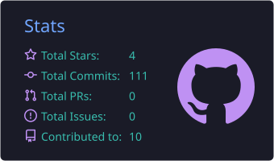
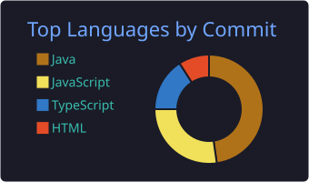
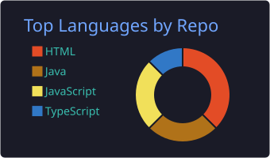
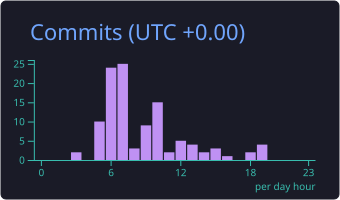

# Hey there! 👋 I'm Shivam Ambekar

### Full Stack Developer | Java | Spring Boot | React.js | Node.js | AI-Powered Applications | Gen AI

---

## 🚀 About Me

- 👨‍💻 Full Stack Developer with 1.5+ years of client project experience
- 🌱 Currently improving my skills in backend development, system design and cloud technologies
- 🤖 Exploring Generative AI, RAG and AI-powered application development
- 🛠️ Experienced with REST APIs, database integration and application development
- 🎯 Skilled in building scalable, user-friendly, real-world software solutions
- 📍 Based in Pune, India
- 💼 Open to exciting software development opportunities

---

## 🧑‍💻 Tech Stack

**Languages, Backend & Frontend**

  

**Databases, Tools & DevOps**

  

**AI & Productivity Tools**

  
  
  

---

## 💻 Featured Projects

### 1. FinTrack AI – AI-Powered Personal Finance Management
**Tech Stack:** Java, Spring Boot, Spring Security, JWT, MySQL, React.js, Spring AI

- Personal finance and expense tracking application
- Secure authentication and role-based access
- Expense categorization, budgets and financial analytics
- AI-powered financial assistant using Ollama

### 2. Total Pest Control Management System
**Tech Stack:** React.js, Node.js, Express.js, MongoDB

- Developed features for admin and technician dashboards
- Implemented role-based access and authentication
- Integrated REST APIs and task management functionality
- Worked on technician scheduling and task tracking

### 3. StayEasy – Hostel & PG Booking Application
**Tech Stack:** Java, Spring Boot, React.js, MySQL, JWT

- Hostel and PG accommodation management
- Multiple user roles including Admin, Owner and User
- Secure authentication and property management
- Google Maps integration for location-based functionality

### 4. Multi-Store Order Management System
**Tech Stack:** Next.js, React.js, TypeScript, Node.js, Express.js, MySQL, Socket.IO

- Multi-store order management
- Real-time order status updates using WebSockets
- Store-based filtering and pagination
- REST API integration and backend order processing

---

## 📊 GitHub Statistics

  
  

  
  

---

## 🏆 Contribution Activity

  <picture>
    <source media="(prefers-color-scheme: dark)" srcset="https://raw.githubusercontent.com/Shivam270101/Shivam270101/output/github-snake-dark.svg" />
    
  </picture>

---

## 🤝 Connect With Me

  
  

---

### 💡 "Building solutions, learning continuously, and growing one commit at a time."

⭐ Thanks for visiting my profile! Feel free to explore my repositories and connect with me.
